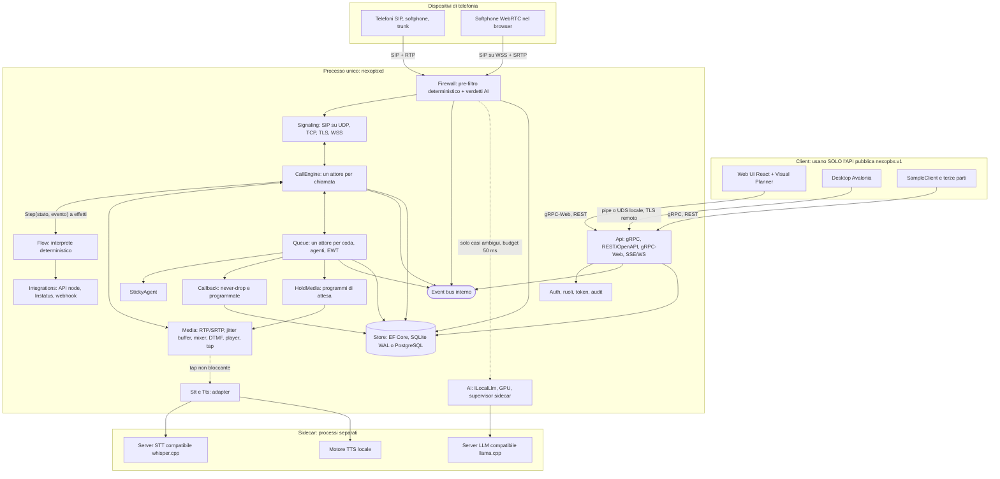
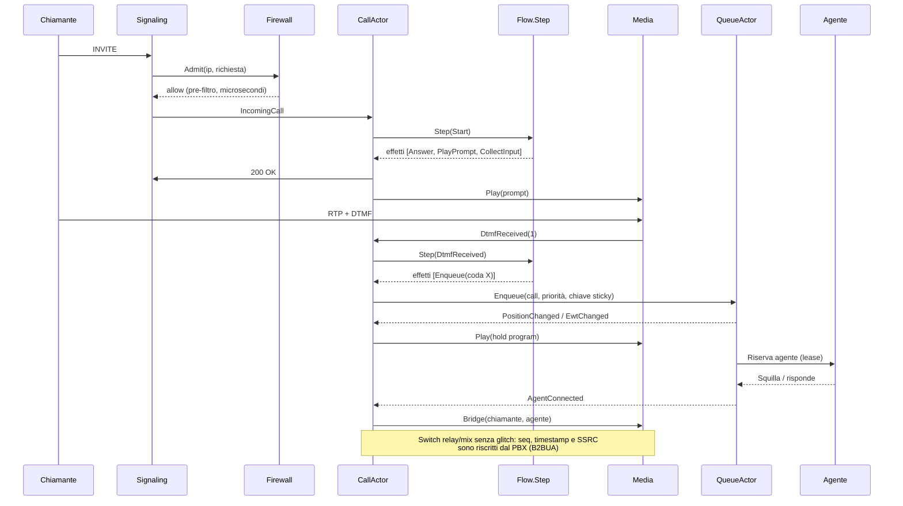
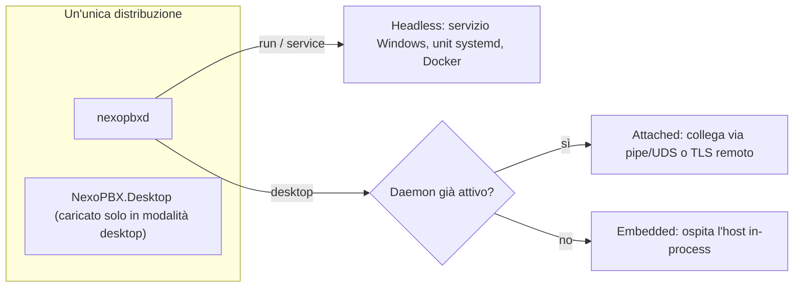

# NexoPBX — Architettura proposta

> Stato: **PROPOSTA, in attesa di approvazione** (nessun codice di feature scritto).
> Aggiornata con le risposte dell'owner: **SIPSorcery** per il signaling, nessuna GPU in sviluppo, trunk senza SMS, prove con softphone + Yealink.
> Lingua: italiano per i documenti di pianificazione; codice, identificatori e API in inglese.
> Documenti collegati: [ROADMAP](ROADMAP.md) · [DECISIONS](DECISIONS.md) · [ADR](adr/README.md)

---

## 1. Sintesi di ciò che ho capito

NexoPBX è un PBX / contact-center **scritto da zero** (niente Asterisk, FreeSWITCH, Kamailio): nostro motore di
chiamata, nostro media, nostra superficie di amministrazione. È **una sola applicazione C# / .NET** che gira su
Windows e Linux, in due modalità: **headless** (servizio Windows / unit systemd / Docker) e **desktop**
(pannello di controllo Avalonia). Tutto — web UI, desktop UI, terze parti — usa **la stessa API pubblica
`nexopbx.v1`** (gRPC come fonte di verità, REST/OpenAPI e gRPC-Web derivati).

Il cuore del prodotto è il **Visual Planner**: un solo editor a grafo in cui si disegna l'intera esperienza di
chiamata (IVR, code, regole, chiamate API, richiamate) senza mai uscirne.

### Assunzioni (le confermo o correggo con te)

| # | Assunzione | Dove è motivata |
|---|---|---|
| A1 | .NET **10 LTS** (supporto fino al 14/11/2028). .NET 8/9 escono dal supporto il 10/11/2026. | ADR-003 |
| A2 | Il PBX sta **sempre nel percorso media** (B2BUA): niente "direct media". Serve per prompt, attese, tap STT, registrazione. | ADR-008 |
| A3 | Una chiamata **non sopravvive** al riavvio del processo (il dialogo SIP/RTP è perso). Sopravvivono code "virtual hold", richiamate, finestre sticky. | §7 |
| A4 | Il softphone del browser usa **G.711 su SRTP** di default; Opus è opzionale. | ADR-008 |
| A5 | Il "tray + control center" in servizio Windows è un **client** del servizio (sessione 0 non può mostrare UI). Se nessun servizio è attivo, il desktop può ospitare il PBX in-process (*embedded*). | ADR-003 |
| A6 | Il contratto gRPC usa **solo unary + server-streaming** (gRPC-Web nel browser non supporta client/bidi streaming). | ADR-004 |
| A7 | Il firewall è un'**ammissione a livello applicativo**; contro DDoS volumetrico serve protezione a monte. Rafforzabile con un *enforcer* OS opzionale (nftables / Windows Filtering). | ADR-010 |
| A8 | Multi-tenant nel modello dati dal giorno 1 (`tenant_id` ovunque), ma l'UI espone un solo tenant finché non serve. | DECISIONS D-003 |
| A9 | Il signaling usa **SIPSorcery** dietro `ISignaling`; B2BUA, RTP, jitter buffer, mixer e prompt player restano **nostri**. | ADR-002 |
| A10 | Nessuna GPU sulla macchina dell'owner: l'AI gira in **CPU**. Il percorso GPU è costruito per altri utenti e validato con sonde finte finché qualcuno con una GPU non lo prova. | ADR-009 |
| A11 | Il trunk dell'owner non supporta SMS: il link "posizione in coda" si consegna via QR/widget web; `ISmsSender` resta un'interfaccia opzionale. | DECISIONS D-022 |

### Cose che ho trovato nel prompt e che vanno risolte (dettagli nelle ADR)

1. **Licenza**: il file `LICENSE` del repo è **AGPL-3.0**, il prompt dice "proprietario". Sono in tensione → ADR-012 (**domanda bloccante**).
2. **SIPSorcery** ha, oltre alla BSD-3, una **clausola d'uso territoriale** nel proprio `LICENSE`. **Deciso dall'owner: lo usiamo** (ADR-002, accettata). Conseguenze: eccezione nominale nel *license check*, file `THIRD_PARTY_NOTICES` che riporta la clausola, `ISignaling` come via d'uscita (piano B: stack proprio).
3. **Single-file + Avalonia**: Skia/HarfBuzz sono librerie native; un headless Docker non deve caricarle → l'assembly Desktop si carica **solo in modalità desktop** (ADR-003).
4. **Funzioni senza milestone** nel prompt: WebRTC bridge, CDR/report, registrazione con consenso, export/cancellazione GDPR, invio SMS del link "posizione in coda". Le ho assegnate (vedi ROADMAP).
5. Il *firewall* "al posto di fail2ban" deve poter **bloccare prima di parsare** e, opzionalmente, **spingere regole al firewall del sistema operativo**, altrimenti un flood continua a bruciare CPU dell'app (ADR-010).

---

## 2. Verifiche d'ambiente già fatte

| Verifica | Esito |
|---|---|
| Repo | Vuoto: solo `LICENSE` (AGPL-3.0) e `README.md` |
| .NET LTS corrente | **.NET 10** (LTS) |
| Container di lavoro | **.NET SDK 10.0.112** installato da `apt` (il download diretto da `dot.net` è bloccato dalla policy di rete) |
| NuGet / npm | Raggiungibili (restore di prova riuscito) |
| Node | v22 presente; Chromium/Playwright preinstallati |
| Docker / psql | Presenti (utili per i test PostgreSQL) |
| Windows | **Non verificabile nel container**: la parità Windows è garantita dalla matrice CI GitHub Actions (`windows-latest` + `ubuntu-latest`) |
| Hardware di prova dell'owner | Un **softphone** e un telefono **Yealink**; trunk senza SMS; **nessuna GPU** |

---

## 3. Obiettivi non funzionali e come li misuriamo

| Obiettivo | Misura | Quando |
|---|---|---|
| ≥ **500 chiamate concorrenti** G.711 su VM 4 vCPU | Generatore di carico (UA proprio + SIPp), numeri documentati | M2 spike, M12 |
| Latenza aggiunta dalla logica NexoPBX < **100 ms** al setup | Metrica `call_setup_overhead_ms` (p50/p99) in simulazione e in integrazione | M2→ |
| Firewall: decisione deterministica p99 < **50 ms** (obiettivo reale: < 1 ms) | Benchmark BenchmarkDotNet + metrica a runtime | M10 |
| **Zero glitch** audio su cambio prompt/musica | Test: sequenza RTP continua (seq/timestamp/SSRC) attraverso ogni transizione | M2 |
| Percorso media **senza allocazioni** a regime | Test di allocazione (`GC.GetAllocatedBytesForCurrentThread`) + istogramma pause GC | M2 |
| Soak **24 h** senza degrado/leak | Job notturno, grafici memoria/handle/thread | M12 |
| AI mai a scapito del media | Isolamento per processo e priorità; test con sidecar spento/saturo | M10 |
| Accuratezza EWT | Harness di simulazione; **obiettivo proposto**: ≥ 80% delle chiamate con attesa reale entro ±max(60 s, 25%) dell'EWT all'ingresso, su traffico stazionario | M4 |

---

## 4. Architettura dei componenti



### 4.1 Regole di dipendenza tra progetti

Il layout del prompt è rispettato; aggiungo **due progetti piccoli** (vedi DECISIONS D-002):
`NexoPBX.Abstractions` (clock, id, event bus, contesto tenant, primitive di dominio) e `NexoPBX.Testing`
(clock virtuale, telefonia finta, runner di scenari).

```
Contracts            ← nessuna dipendenza (solo .proto e tipi generati)
Abstractions         ← Contracts
Flow, Queue          ← Abstractions            (logica pura: NESSUN I/O, NESSUN socket, NESSUN DB)
StickyAgent, Callback, HoldMedia ← Abstractions, Queue
Signaling, Media     ← Abstractions            (I/O di rete; non conoscono Flow né Queue)
CallEngine           ← Flow, Queue, Signaling(astrazioni), Media(astrazioni)
Store                ← Abstractions            (implementa repository; nessuna logica di dominio)
Firewall, Ai, Stt, Tts, Integrations ← Abstractions
Api                  ← tutti i servizi tramite interfacce
App                  ← composition root: l'unico che conosce tutte le implementazioni
Desktop              ← Contracts (solo API pubblica; NON referenzia i moduli del server)
Testing              ← Abstractions (+ fornisce fake di Signaling/Media)
```

Un test di architettura (NetArchTest / analyzer) fa fallire la CI se `Flow` o `Queue` toccano `System.Net`,
`System.IO` o il DB, o se `Desktop` referenzia un modulo server.

---

## 5. Modello di concorrenza

**Principio:** *nessun lock nella logica di dominio*. Lo stato mutabile appartiene a un solo "proprietario"
che lo modifica in modo seriale; tutto il resto comunica con messaggi.

| Ambito | Meccanismo | Note |
|---|---|---|
| **Socket SIP** (UDP/TCP/TLS/WSS) | Loop di ricezione asincroni con buffer da `ArrayPool`; il parser lavora su `ReadOnlySpan<byte>` | Il blocklist-check avviene **prima** del parsing (lookup O(1) su snapshot immutabile) |
| **Chiamata** | **Un attore per chiamata**: `Channel<CallEvent>` con singolo lettore. Eventi da SIP, DTMF, timer, flow, comandi API passano tutti da lì | Ordine deterministico, niente race nella logica; `CallScope` possiede CTS, timer e sessione media e li rilascia in modo deterministico |
| **Coda** | **Un attore per coda**: serializza entrate, uscite, riservazioni agente, ricalcolo EWT | Equità e ordinamento sono testabili in modo deterministico |
| **Agenti / presenza** | Stato posseduto dall'attore della coda (o di un `AgentDirectory` serializzato) | Le riservazioni agente sono **lease con scadenza** (nessun agente "squilla a vuoto") |
| **Media** | **K thread dedicati** (K ≈ core/2), ognuno con uno *shard* di sessioni e un tick da **20 ms**; priorità alta tramite astrazione (`IThreadPriority`: MMCSS su Windows; `nice`/`SCHED_FIFO` opzionale su Linux, con fallback) | Pacing: `Stopwatch` + sleep ibrido (sleep fino a ~0,3 ms dalla scadenza, poi spin). Su Windows risoluzione timer a 1 ms |
| **Ricezione RTP → jitter buffer** | Ring buffer **SPSC lock-free**, buffer da pool | Frame in ritardo/eccedenti vengono scartati e contati; il media non aspetta mai nessuno |
| **Tap STT** | Fork dei frame PCM su ring SPSC dedicato; consumatore su altro thread; se in ritardo **scarta** | Impatto zero sulla qualità della chiamata (obbligo del §5.4) |
| **Persistenza** | Un **writer seriale** con batching (group commit) per SQLite; pool di connessioni per PostgreSQL | CDR, eventi e decisioni firewall sono *append-only* con writer a batch |
| **AI** | `HttpClient` verso il sidecar, concorrenza limitata da semaforo con **priorità** (firewall > STT > riassunti) | Timeout rigidi; al superamento si applica la *fail-mode* |
| **Event bus** | Canali **limitati** per sottoscrittore | Politica per canale: UI → *coalesce/drop con marker di resync*; webhook → outbox durevole; media → mai bloccante |

**Backpressure:** ogni `Channel` è `Bounded`; per ognuno è scritta (nel codice e in `docs/`) la politica a
saturazione (drop-oldest / coalesce / blocca-con-timeout / degrada). **Cancellazione:** ogni attore ha un CTS
collegato al ciclo di vita della chiamata; test di *leak* verificano che dopo N chiamate task, thread, handle e
socket tornino a zero.

**GC (da misurare, non da dare per scontato):** Workstation GC concorrente, `SustainedLowLatency` nelle fasi
critiche, niente allocazioni nel percorso media, ReadyToRun + TieredPGO. Le impostazioni definitive vengono
fissate con la prova da 24 h; l'istogramma delle pause GC è una metrica esposta.

---

## 6. Come interagiscono CallEngine, Flow e Media

**Idea chiave: "functional core, imperative shell".** L'interprete del flusso è una funzione pura e
deterministica:

```
Flow.Step(FlowSnapshot, CallState, FlowEvent) → (CallState', IReadOnlyList<FlowEffect>)
```

Non fa I/O e non legge l'ora: emette **effetti** (`Answer`, `PlayPrompt`, `CollectInput`, `Enqueue`,
`CallApi`, `StartTimer`, `Bridge`, `Hangup`, …). Il `CallEngine` li esegue contro le interfacce
`ISignaling` / `IMediaSession` / `IQueueGateway` / `IApiClient` e rimanda al flusso gli esiti come eventi
(`PromptFinished`, `DtmfReceived`, `ApiResult`, `TimerFired`, …).

Conseguenze: lo **stesso interprete** gira in produzione, nel **simulatore del Planner**, nella **CLI** e nei
**test con clock virtuale** — il flusso testato è identico al flusso eseguito. La versione del flusso è un
**`FlowSnapshot` immutabile**: ogni chiamata resta agganciata alla versione con cui è iniziata, quindi la
pubblicazione è atomica e non interrompe le chiamate in corso.



**Media: due modalità per ogni ponte.** *Relay* (stesso codec, nessuna trascodifica, RTP inoltrato con
numerazione riscritta) e *Mix* (decodifica → PCM16 → mixer → codifica, usata per prompt, tap, registrazione).
Il passaggio fra le due preserva continuità di sequenza e timestamp: è così che si ottiene "zero glitch".

---

## 7. Persistenza e crash recovery

| Dato | Dove vive | Durabilità | Dopo un crash / riavvio |
|---|---|---|---|
| Chiamata live (dialogo SIP, RTP) | Memoria (`CallActor`) | No | Persa. All'avvio un marker di heartbeat permette di chiudere i CDR orfani come `dropped_by_restart` |
| Chiamante in coda (leg connessa) | Memoria + snapshot periodico | Parziale | Non recuperabile (la leg media è persa); resta nelle statistiche |
| **Virtual hold / never-drop** | DB, *write-through* | Sì | Ricostruito all'avvio con ordine deterministico (numero di sequenza monotono dal DB) |
| **Richiamate programmate** | DB, *write-through* | Sì | Scheduler ricaricato; le scadute entro tolleranza partono, le altre vanno in policy di ritardo documentata |
| **Legame sticky** (chiamante→agente, finestra) | DB, scritto alla connessione | Sì | Ricaricato; le finestre scadute scartate |
| Presenza agenti | Memoria + ultimo stato su DB | Parziale | Tutti *offline* finché non si ri-registrano via SIP |
| Memoria del firewall (profili IP) | Cache in memoria + DB *write-behind* | Sì | Ricaricata a batch |
| Versioni di flusso | DB, immutabili | Sì | — |
| CDR, eventi, decisioni firewall | DB, *append-only* a batch | Sì | Ultimi batch non scritti possono perdersi: finestra ≤ 1 s, documentata |

Regole generali: operazioni **idempotenti** (chiavi di idempotenza sulle richieste di richiamata), **shutdown
con drain** (stop nuove chiamate → completamento/trasferimento → flush dei writer), migrazioni per entrambi i
provider (SQLite e PostgreSQL) testate in CI.

---

## 8. API pubblica

- `NexoPBX.Contracts` (`nexopbx.v1`): `FlowService`, `QueueService`, `AgentService`, `CallService`,
  `CallbackService`, `FirewallService`, `PromptService`, `IntegrationService`, `AiService`, `UserService`,
  `EventService`, `SystemService`.
- **Solo unary e server-streaming** (A6). L'`EventService` espone anche un mirror **SSE/WebSocket**.
- Convenzioni: *field mask* sugli aggiornamenti, token di paginazione, `etag`/`version` per la concorrenza
  ottimistica, modello d'errore uniforme leggibile da macchine.
- Trasporti: TCP+TLS; **named pipe** (Windows) / **Unix domain socket** (Linux) per il collegamento locale.
- Compatibilità: **`buf breaking`** in CI blocca ogni modifica non additiva dentro `v1` (`docs/API_VERSIONING.md`).
- OpenAPI 3.1: da verificare in uno *spike* di M1 se il transcoding ufficiale lo produce; altrimenti
  generazione a build-time dai `.proto`.

---

## 9. Modalità di esecuzione



Un **lock di istanza singola** (mutex / file lock) evita due host sulla stessa porta. In tutti i casi la UI
parla con il server **solo tramite il contratto pubblico**, anche in-process.

---

## 10. Sicurezza (riepilogo)

Ruoli Owner/Admin/Supervisor/Agent/ReadOnly/ApiClient · argon2id · TOTP opzionale · token scoped · mTLS per
client macchina · audit completo · segreti cifrati a riposo (chiave master da DPAPI su Windows / file 0600 o
variabile d'ambiente su Linux, KMS esterno in futuro) · TLS configurabile ovunque · CORS stretto · CSRF per la
web app · rate limiting su ogni endpoint pubblico · **la pagina "posizione in coda" del chiamante usa token
non indovinabili, a scadenza, con rate limit** · stringhe controllate da un attaccante (User-Agent, display
name) sempre sanificate e passate al modello come dati citati, mai come istruzioni.

---

## 11. AI locale e GPU (sintesi di ADR-009)

Sidecar gestito dall'app (avvio, health-check, riavvio con backoff), compatibile OpenAI/llama.cpp, dietro
`ILocalLlm` + `IChatClient`. Rilevamento GPU (NVIDIA/NVML, Vulkan via il sidecar stesso, fallback CPU
AVX2/AVX-512), *VRAM budget manager* condiviso fra firewall e STT, import di GGUF locali con checksum,
hot-swap con rollback automatico. Degrado a gradini: modello più piccolo → firewall solo deterministico.
`nexopbxd llm bench` misura l'hardware reale. Output del modello vincolato a uno schema JSON (grammatica) **e**
validato lato C#: un output non valido equivale a "sconosciuto".

I binari del sidecar (varianti CUDA/Vulkan/CPU) sono **pesanti**: vanno in un **pacchetto "AI pack"
opzionale**, non nell'installer base. Nessun modello viene incluso (licenze): l'utente importa i GGUF.

**Nota hardware:** l'owner non ha una GPU. Il percorso di riferimento è quindi **CPU** con un modello piccolo; su CPU l'AI non rispetta i 50 ms, perciò lì il verdetto è sempre **asincrono** ("decidi ora, impara dopo") e il peso lo regge il pre-filtro deterministico. Il codice per CUDA/Vulkan viene scritto e testato con sonde finte; la validazione su GPU vera dipende da chi ne ha una.

---

## 12. Firewall (sintesi di ADR-010)

1. **Pre-parse**: blocklist su snapshot immutabile (trie CIDR) → drop in microsecondi.
2. **Pre-filtro deterministico**: whitelist (vince sempre), range locali (consentiti ma contati), contatori
   token-bucket per IP/subnet/account, pacchetti malformati, User-Agent noti da scanner.
3. **Casi ambigui → AI** con budget di 50 ms. Poiché la decisione AI si applica soprattutto alle richieste
   *successive* ("decidi ora, impara in modo asincrono"), il percorso caldo non aspetta il modello.
4. **Verdetto** `{action, confidence, reasons[], ttl_seconds}` validato; invalido ⇒ "unknown" + fail-mode.
5. **Rete di sicurezza**: modalità *monitor* (solo log) per tenant, mai auto-blocco di IP con registrazione/
   chiamata autenticata attiva senza allarme umano, blocchi sempre con TTL, override in un clic.
6. **Volume**: le decisioni ripetitive sono **aggregate** (contatori per IP) invece di una riga per pacchetto.

---

## 13. Strategia di test (sintesi)

- `NexoPBX.Testing`: **clock virtuale** + **telefonia finta** → scenari interi in millisecondi, descritti in
  un **DSL YAML**. I sei scenari richiesti dal prompt (sticky con agente occupato; attesa lunga → richiamata
  con priorità; never-drop con retry senza risposta; annuncio Instatus degradato → tasto 1; firewall che
  blocca scanner ma lascia passare la LAN; pubblicazione del flusso con chiamate attive) sono test di CI.
- Integrazione SIP/RTP con UA proprio + **SIPp** (strumento esterno, non linkato) ; fuzzing su parser SIP e
  import JSON dei flussi; test di concorrenza e di leak; analizzatori Roslyn severi.
- Web: Vitest + Playwright (creare 4 code, collegarle, pubblicare, simulare). Desktop: Avalonia.Headless.
- Cosa si verifica **dove**: container di lavoro (Linux: build, unit, simulazione, Playwright, PostgreSQL via
  Docker); **CI** (Windows + Linux: matrice completa); **hardware tuo** (softphone + Yealink + trunk reale; niente GPU: i percorsi GPU si validano con sonde finte e poi con chi ne ha una).

---

## 14. I 10 rischi tecnici principali

| # | Rischio | Impatto | Mitigazione |
|---|---|---|---|
| 1 | **Interoperabilità SIP** (SIPSorcery + nostro B2BUA): quirk di telefoni e trunk, NAT, re-INVITE, session timers, 100rel, modalità DTMF; dipendenza da una libreria di terze parti con clausola d'uso | Chiamate che non si stabiliscono / audio unidirezionale / aggiornamenti bloccati | Spike di carico e interoperabilità già in M2, scenari SIPp, fuzzing dei nostri parser, profili "quirk" per trunk, prova su Yealink + softphone + trunk reale, versioni fissate, `ISignaling` come via d'uscita (piano B: stack proprio) |
| 2 | **NAT e WebRTC** senza DTLS nativo in .NET | Softphone web inutilizzabile dietro NAT simmetrici | ICE-lite (il server ha IP raggiungibile), DTLS-SRTP via libreria matura (licenza da verificare), G.711 per evitare Opus, TURN esterno (coturn) documentato, `external_ip`/range RTP configurabili, *symmetric RTP latching* |
| 3 | **Jitter, latenza, GC** in .NET sotto carico (anche su VM condivise e timer Windows) | Glitch audio | Media senza allocazioni, thread dedicati, jitter buffer adattivo, metriche GC, spike di carico già in M2, soak 24 h |
| 4 | **Falsi positivi dell'AI firewall** | Clienti legittimi bloccati | Monitor-first, whitelist vince, mai blocco con sessione attiva, TTL crescenti, spiegazione + override, replay in "shadow mode", interruttore d'emergenza |
| 5 | **Firewall sotto flood** (CPU applicativa, volume di decisioni) | Servizio degradato | Drop pre-parse, decisioni aggregate, enforcer OS opzionale, avviso chiaro che il DDoS volumetrico richiede difese a monte |
| 6 | **Accuratezza EWT** (traffico non stazionario, abbandoni, skill) | Promesse sbagliate ai chiamanti | Harness di simulazione con target come test di regressione, isteresi, "circa", banda di confidenza, ripiego sulla sola posizione se i dati sono pochi |
| 7 | **Correttezza e equità delle richiamate** (doppie prenotazioni, agenti riservati a vuoto, perdite al riavvio, regole sulle chiamate in uscita) | Clienti dimenticati o agenti bloccati | Lease con scadenza, chiavi di idempotenza, macchine a stati persistite con test esaustivi delle transizioni, test property-based sull'ordinamento, capacità per slot, liste DNC, E.164 |
| 8 | **Ampiezza del Planner** (≈ 20 tipi di nodo, undo/redo, simulatore, diff, overlay) | Planner incompleto o instabile | Schema JSON del flusso e interprete **prima** della UI (M3) con golden test; Planner in 3 fette verticali; E2E Playwright |
| 9 | **Parità Windows/Linux e packaging** (servizio in sessione 0, librerie native Avalonia/Skia, MSI, porte < 1024, regole firewall) | Funziona solo su un OS | Matrice CI dal giorno 1; spike installer in M1 e M8 (non solo in M12); modalità desktop caricata a richiesta; licenza del toolchain MSI da verificare |
| 10 | **AI/GPU**: crash del sidecar, VRAM contesa, driver, pesantezza dei binari, licenze dei modelli | Firewall/STT indisponibili | Sidecar isolato con supervisor, VRAM budget, degrado a gradini, "AI pack" opzionale, import offline, nessun modello incluso |

---

## 15. Conferme richieste

- **Avalonia invece di MAUI** → confermo e raccomando (MAUI non ha supporto Linux ufficiale; WPF/WinForms solo Windows). ADR-001.
- **LLM in sidecar + strategia GPU** → confermo (un crash CUDA/nativo non deve mai toccare le chiamate). ADR-009.
